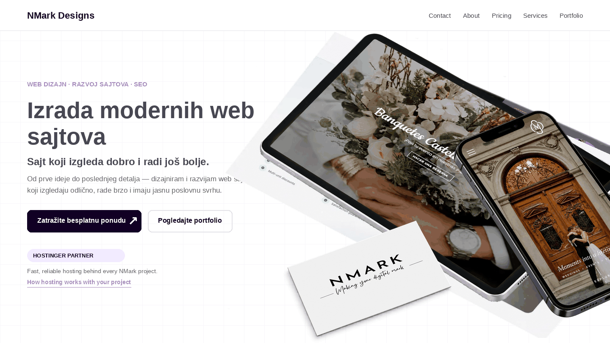
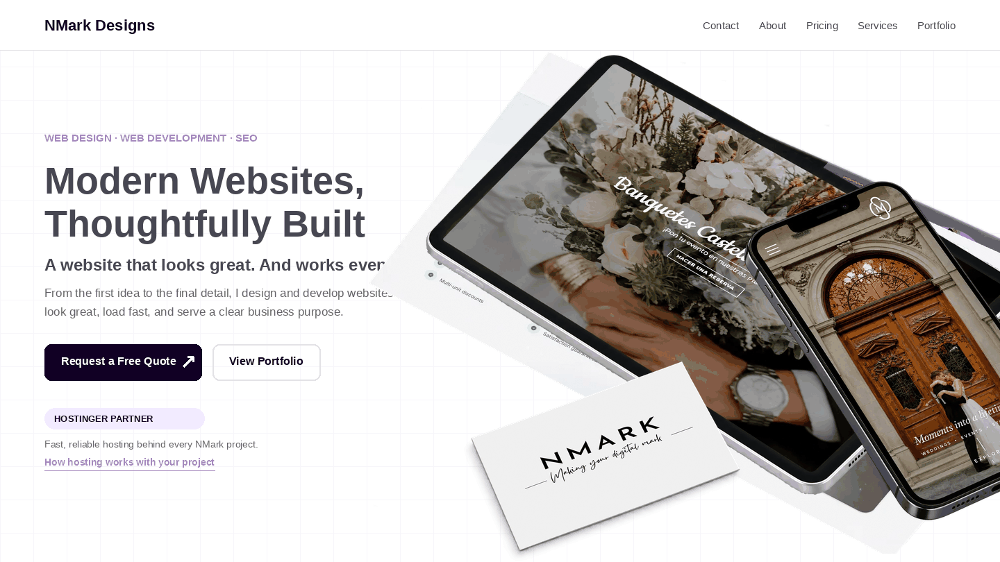
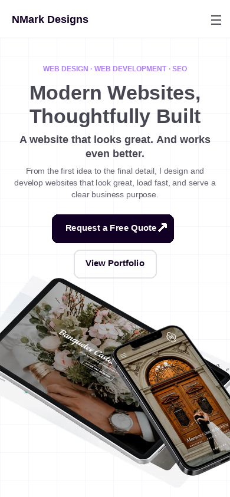

# NMark Designs

Modern rebuild of [nmarkdesigns.com](https://nmarkdesigns.com/) using the **Next.js App Router**, **React**, **strict TypeScript**, and **Tailwind CSS v4**. The site is bilingual (Serbian and English), statically generated on the server, progressive-enhancement friendly, and SEO-hardened with canonical URLs, hreflang alternates, JSON-LD, and host-aware crawl policy.

## Preview

**Hero section — desktop, Serbian (`/sr/`, default locale):**



**Hero section — desktop, English (`/en/`):**



**Hero section — mobile (390 × 844, stacked layout):**



> Note: these are design-faithful mockups rendered from the production hero copy (`content/i18n/`), brand colors (`app/globals.css`), and layered artwork assets (`public/images/hero-assets/`). They use fallback system fonts rather than the DM Sans webfont, so typefaces differ slightly from the live site. To capture pixel-exact screenshots yourself, run `npm run build && npm run start` and photograph `http://localhost:3000/sr/`.

## Contents

- [Preview](#preview)
- [Features](#features)
- [Tech Stack](#tech-stack)
- [Getting Started](#getting-started)
- [Environment Variables](#environment-variables)
- [Available Scripts](#available-scripts)
- [Project Structure](#project-structure)
- [Localization](#localization)
- [SEO & Routing](#seo--routing)
- [AI Chatbot & Admin Panel](#ai-chatbot--admin-panel)
- [Contact Form Status](#contact-form-status)
- [Testing](#testing)
- [Documentation](#documentation)

## Features

- **Bilingual static site** — Home, Portfolio (with project case studies), Services, About, Contact, Pricing, Blog, and Privacy pages in `/sr/` and `/en/`. The root redirects permanently to `/sr/`; no browser-language detection is used.
- **Server-first rendering** — Pages and layouts render on the server. Client boundaries are minimal: `MobileNavigation`, `LanguageSwitcher`, `FAQAccordion`, `ContactForm`, and the chatbot widgets. Language links, FAQ answers, and the contact form all work without JavaScript.
- **Typed content layer** — All localized copy lives in typed dictionaries (`content/i18n/`); project data in `content/projects.ts`; shared business facts in `content/site.ts`. No duplicated localized JSX.
- **SEO infrastructure** — Localized metadata with self-canonicalizing pages, `hreflang` alternates (`x-default` → Serbian), dynamic `robots.txt` and `sitemap.xml`, verified JSON-LD (Organization, WebSite, Person, BreadcrumbList), and `llms.txt`.
- **Legacy migration** — Exact approved WordPress URL mappings redirect permanently; unknown locales, slugs, case variants, and extra segments return 404.
- **Optional AI chatbot** — OpenAI-powered lead-capture assistant with scope/topic policy, budget ceilings, rate limiting, MySQL persistence via Drizzle, and an owner-only Auth.js admin panel. Disabled by default in production (`CHAT_ENABLED=false`).

## Tech Stack

| Area | Choice |
| --- | --- |
| Framework | Next.js 16 (App Router, webpack build), React 19 |
| Language | TypeScript (strict) |
| Styling | Tailwind CSS v4, self-hosted DM Sans via `next/font/google` |
| Data / DB | Drizzle ORM + MySQL (`mysql2`) for chatbot leads and admin |
| Auth | NextAuth v5 (beta, Drizzle adapter), owner-email allowlist |
| AI | OpenAI SDK with explicit model/pricing/budget configuration |
| Validation | Zod |
| Testing | Playwright (Chrome channel) + axe-core accessibility checks |
| Linting | ESLint 9 (`eslint-config-next`) |

## Getting Started

Requires Node.js 24 LTS (see `.nvmrc`) and npm.

```sh
npm ci
npm run dev
```

Open <http://localhost:3000/sr/> or <http://localhost:3000/en/>. The root `/` redirects to `/sr/`. If the port is occupied, use another one: `npm run dev -- --port 3001`.

> **Note:** DM Sans is fetched at build time by `next/font/google`; the first build needs access to Google's font service. Latin and Latin Extended subsets cover Serbian Latin text.

The local chatbot demo works out of the box in development (preview mode, no env file required). See [AI Chatbot & Admin Panel](#ai-chatbot--admin-panel) for real backend setup.

## Environment Variables

Copy `docs/chatbot/env.example` into your local environment (e.g. `.env.local`). Never commit real secrets. Key groups:

- **Chatbot**: `CHAT_ENABLED`, `CHAT_PREVIEW`, `CHAT_ORIGIN`, `CHAT_IDENTITY_SECRET`, `OPENAI_API_KEY`, `OPENAI_MODEL`, output/token/time limits, `CHAT_BUDGET_DAY_USD` / `CHAT_BUDGET_MONTH_USD`, explicit per-million token prices, retention flags.
- **Database**: `DB_HOST`, `DB_PORT`, `DB_NAME`, `DB_USER`, `DB_PASSWORD`, `CHAT_MIGRATION_TARGET`.
- **Admin auth**: `AUTH_SECRET`, `AUTH_URL`, `ADMIN_ALLOWED_EMAIL` (exact owner identity; never inferred).
- **Leads & mail**: `CHAT_LEAD_RECIPIENT`, `CHAT_EMAIL_ENABLED`, `CHAT_CRON_SECRET`, and the shared `SMTP_*` variables.
- **Consent/trust**: `CHAT_PRIVACY_URL_SR` / `CHAT_PRIVACY_URL_EN` (verified published policy URLs, required for both locales), optional `CHAT_TRUSTED_IP_HEADER` (only after verifying proxy behavior).

Production keeps `CHAT_ENABLED=false` until the full MVP is approved, and `CHAT_PREVIEW` is development-only.

## Available Scripts

```sh
npm run lint              # ESLint, zero warnings allowed
npm run typecheck         # next typegen + tsc --noEmit
npm run build             # production build (webpack)
npm run start             # serve the production build

npm run test:e2e          # main Playwright suite (Chrome, prod build on :3100)
npm run test:chatbot      # chatbot suite (playwright.chatbot.config.ts)
npm run test:admin        # admin panel suite (playwright.admin.config.ts)

npm run chat:db:generate        # drizzle-kit generate migrations
npm run chat:db:migrate:dev     # apply migrations (.env.local required)
```

Build before running browser tests. Screenshots and failure traces go to the ignored `test-results/` directory.

ESLint 9 is pinned deliberately to stay within the React lint plugin's supported peer range (npm marks this major deprecated); update the lint toolchain when that plugin supports ESLint 10. Development tooling only.

## Project Structure

```text
app/
  [locale]/            Localized root layout; home, portfolio, blog, services,
                       and catch-all core pages ([page]) — statically generated
  admin/               Owner-only chatbot/leads admin (Auth.js gated)
  api/                 Route handlers: chat, auth, admin
  robots.ts sitemap.ts manifest.ts llms.txt   Crawl & PWA outputs
components/
  layout/ home/ portfolio/ blog/ services/ about/ contact/ pricing/ privacy/
                       Page-section components (server-rendered by default)
  chatbot/ admin/ ui/ seo/
content/
  site.ts              Shared verified business information (canonical origin)
  i18n/                Typed sr/en dictionaries, loaded on the server
  projects.ts blog*.ts services.ts pricing.ts consent.ts privacy.ts partners.ts
lib/
  i18n.ts routes.ts    Locale types and semantic route → translated slug mapping
  metadata.ts public-pages.ts legacy-redirects.ts seo-config.ts crawl.ts schema.ts
  contact*.ts          Typed form state, validation, and delivery adapter
  chatbot/             Config, provider, budget, topic policy, DB schema,
                       migrations, leads, security, maintenance scripts
proxy.ts               Permanent redirects, trailing-slash normalization,
                       strict route validation, host-aware noindex headers
tests/                 Playwright suites (behavior, layout, a11y, SEO, perf)
docs/                  Reference material, phase reports, chatbot ops docs
public/                Migrated local assets (logo, images, projects)
```

Small client boundaries: `MobileNavigation`, `LanguageSwitcher`, `FAQAccordion`, `ContactForm`, chatbot widgets. With JavaScript, the FAQ exposes button controls and expanded state (first answer open); without it, all answers remain visible.

## Localization

- Add shared fields to `content/i18n/types.ts` and provide **both** dictionaries; resolve them with `getDictionary(locale)` in Server Components.
- Business information belongs in `content/site.ts`; project-specific content in `content/projects.ts`.
- `lib/routes.ts` maps semantic route keys to translated slugs. Once a core page exists in **both** languages, set its `implemented` flag to `true` and use `localizedPath` for metadata.
- The language switcher maps equivalent paths (including future portfolio detail slugs) and stores no locale in React state, cookies, or localStorage. Unknown routes have no switch target.

## SEO & Routing

- 46+ public localized pages across `/sr/` and `/en/`, including eight project case studies, eight blog articles, About, Contact, Pricing, Services, and Privacy.
- `/` permanently redirects (308) to `/sr/`; exact legacy WordPress paths redirect directly to their Serbian equivalents, including slashless requests. Valid localized pages normalize to trailing slashes. Unknown locales/slugs/case variants/extra segments → 404.
- Canonical production pages emit `index, follow`. `sitemap.xml` lists canonical pages only — no fabricated modification dates or ranking hints. JSON-LD uses verified content only.
- Indexing is allowed **only** on the exact configured production host; any other host receives `X-Robots-Tag: noindex, nofollow` and a disallow-everything `robots.txt`. Keep hosting-level deployment protection on for previews — robots rules are not access control.
- Configure HTTPS and redirect `www`/HTTP aliases at the hosting layer. Do not reuse a production artifact on an unprotected preview host that bypasses the Next.js proxy.

## AI Chatbot & Admin Panel

An optional OpenAI-backed assistant (`components/chatbot/`, `lib/chatbot/`, `app/api/chat`) that qualifies visitors and captures leads into MySQL. Guardrails include a topic/scope policy (greetings and obvious off-topic redirects avoid paid generation), daily/monthly call and USD budget ceilings, timeouts, rate limiting, and consent links to verified privacy policies in both locales.

- **Development**: preview mode is enabled by default under `npm run dev`; set `CHAT_PREVIEW=false` to exercise the real configured backend.
- **Database**: configure `DB_*` in `.env.local`, then `npm run chat:db:generate` and `npm run chat:db:migrate:dev`.
- **Admin**: owner-only Auth.js sign-in restricted to `ADMIN_ALLOWED_EMAIL` at `/admin`. Lead email delivery stays opt-in (`CHAT_EMAIL_ENABLED=false`) until delivery and cron are reviewed.
- Full operational details live in [`docs/chatbot/`](docs/chatbot/) (deployment, operations, lead delivery, privacy review, local testing, QA follow-up).

## Contact Form Status

Contact delivery is **deliberately unavailable** until a mail provider is integrated. `lib/contact-delivery.ts` sends and stores nothing; `available: false` surfaces an upfront notice, and the Server Action validates input and honestly reports unavailability instead of claiming success. Enabling delivery requires an approved provider/SMTP service, server-only credentials, verified sender/recipient, spam/rate controls, and delivery tests. Do not flip the flag or return `accepted` without a real provider acknowledgement. See [the Phase 5B report](docs/phase-5b-report.md).

## Testing

Browser tests use Google Chrome and start the production build on port 3100 (SMTP, rate limiting, and Turnstile are disabled for the test server). Install Chrome locally, or run `npx playwright install chrome` in CI. Always build first:

```sh
npm run build && npm run test:e2e
```

Three suites exist: the main site suite (`playwright.config.ts`), the chatbot suite (`playwright.chatbot.config.ts`), and the admin suite (`playwright.admin.config.ts`). Tests cover behavior, layout, localization, SEO headers, customer journeys, performance budgets, and accessibility (axe-core).

## Documentation

- [AGENTS.md](AGENTS.md) — frontend agent guidelines and brand-fidelity rules
- [Implementation plan](docs/implementation-plan.md) · [Migration notes](docs/migration-notes.md) · [Frontend guidelines](docs/frontend-agent.md)
- Phase reports in [`docs/`](docs/) — e.g. [Phase 6 (SEO)](docs/phase-6-report.md), [Phase 5B (contact)](docs/phase-5b-report.md)
- [`docs/chatbot/`](docs/chatbot/) — chatbot implementation, deployment, and operations
- [`docs/reference/`](docs/reference/) — original-site references and project content sources
