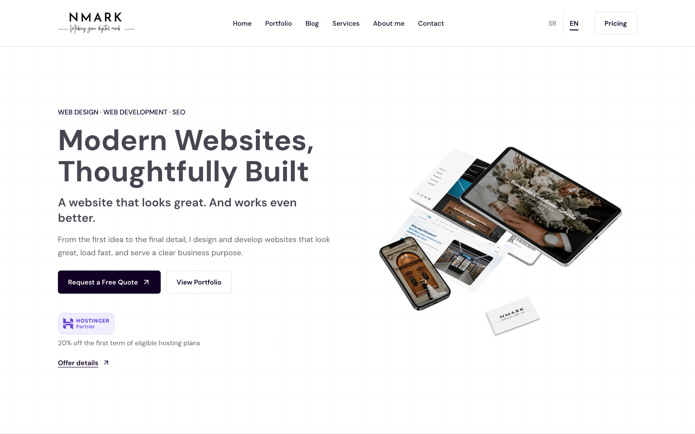
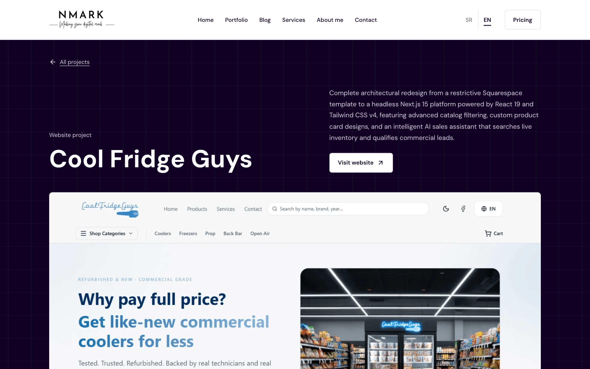
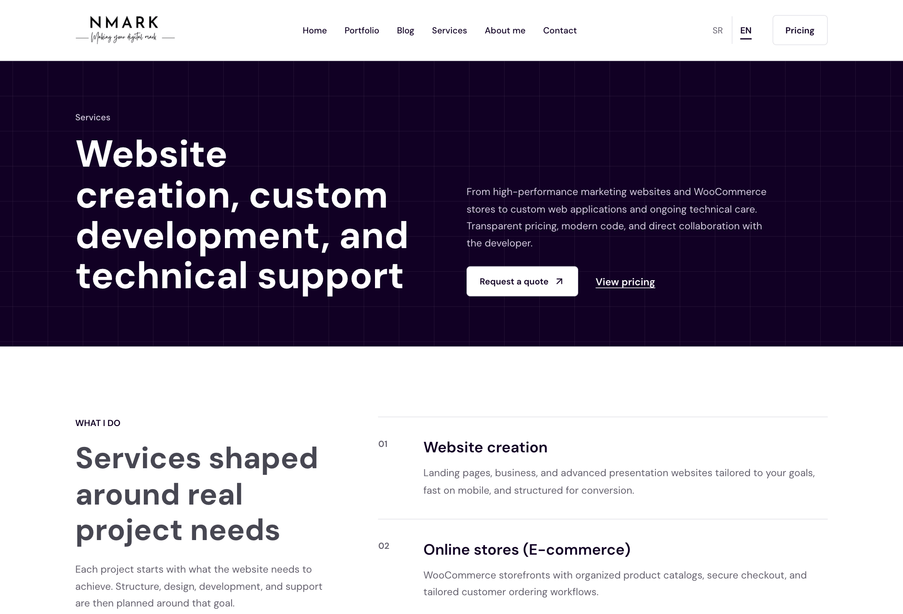
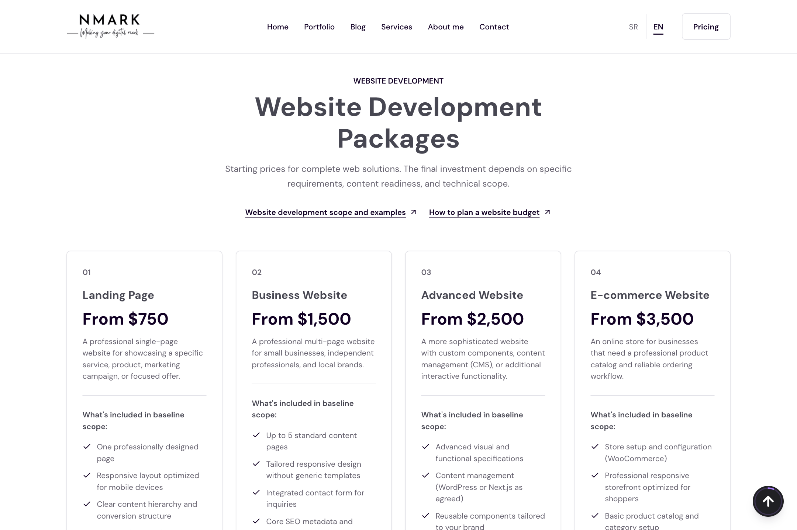
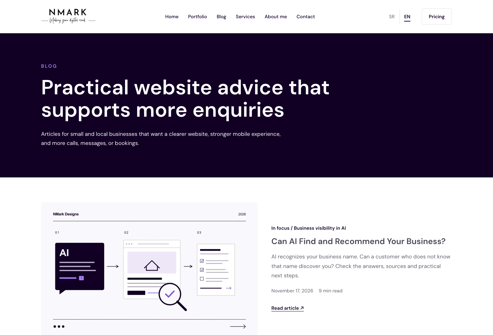

# NMark Designs

Production website for [nmarkdesigns.com](https://nmarkdesigns.com/), rebuilt from WordPress with Next.js 16 (App Router), React 19, strict TypeScript, and Tailwind CSS v4.



## Highlights

- **Bilingual architecture (`sr` / `en`)**: 76 localized public routes defined in `lib/public-pages.ts` — Homepage, Portfolio index (17 projects, 11 full case studies), Services index + 6 dedicated service pages, Blog (13 bilingual articles), About, Contact, Pricing, and draft Privacy Policy pages. `/` permanently redirects to `/sr/`.
- **Market-specific pricing**: Single typed pricing registry in `content/pricing.ts` — Serbian (`/sr/cenovnik/`) uses EUR; English (`/en/pricing/`) uses US market USD prices. Public pages, structured data, chatbot knowledge, and `/llms.txt` all derive offers from this registry.
- **Hardened contact form**: Progressively enhanced Server Action with explicit validation, Nodemailer SMTP delivery (`lib/contact-delivery.ts`), Cloudflare Turnstile verification (`lib/turnstile.ts`), and rate limiting (`lib/rate-limit.ts`).
- **AI assistant & owner admin panel**: OpenAI-backed bilingual chatbot (`components/chatbot/`, `lib/chatbot/`) with MySQL + Drizzle ORM storage, strict topic policy, daily/monthly call and USD budget guards, reviewed lead capture with durable email outbox, and an Auth.js magic-link admin panel (`/admin`).
- **SEO, AIO & security**: Self-canonicalized pages with `hreflang` alternates (`sr`, `en`, `x-default`), verified JSON-LD (`lib/schema.ts`), dynamic `/robots.txt`, `/sitemap.xml`, `/llms.txt`, consent-gated Google Analytics, exact legacy WordPress 308 redirects, and `proxy.ts` security headers (CSP, HSTS, `X-Frame-Options: DENY`, `X-Content-Type-Options: nosniff`, `Referrer-Policy`, `Permissions-Policy`, and host-aware `X-Robots-Tag`).

## Preview

| Case Study | Services |
| --- | --- |
|  |  |

| Pricing Packages | Blog |
| --- | --- |
|  |  |

## Development

Requires Node.js 24 LTS (see `.nvmrc`; `package.json` requires `>=22.0.0`) and npm.

```sh
npm ci
npm run dev
```

Open `http://localhost:3000/sr/` or `http://localhost:3000/en/` (the root redirects to `/sr/`). Pass `-- --port 3001` if port 3000 is in use.

Local development works without environment variables. Under `npm run dev`, the chatbot runs in local preview/demo mode by default; see [docs/chatbot/local-testing.md](docs/chatbot/local-testing.md) and [docs/chatbot/env.example](docs/chatbot/env.example) for live AI, MySQL, and admin panel setup.

### Environment Variables

- **Contact form & analytics** (optional locally; required for production delivery): `SMTP_HOST`, `SMTP_PORT`, `SMTP_SECURE`, `SMTP_USER`, `SMTP_PASSWORD`, `CONTACT_RECIPIENT`, `TURNSTILE_SECRET_KEY`, `NEXT_PUBLIC_GA_MEASUREMENT_ID`.
- **Chatbot, MySQL & Admin**: documented in full in [docs/chatbot/env.example](docs/chatbot/env.example).

## Scripts & Verification

```sh
npm run lint         # ESLint with --max-warnings=0
npm run typecheck    # next typegen && tsc --noEmit
npm run build        # next build --webpack
npm run test:e2e     # Core Playwright E2E suite (port 3100)
npm run test:chatbot # Chatbot Playwright suite (port 3110)
npm run test:admin   # Admin panel Playwright suite (port 3115)
```

Database schema commands (Drizzle ORM / MySQL):

```sh
npm run chat:db:generate     # Generate Drizzle SQL migrations
npm run chat:db:migrate:dev  # Apply migrations using .env.local
```

Browser tests use Google Chrome against a production build (`npm run build` first; install Chrome locally or run `npx playwright install chrome` in CI). The performance QA config (`playwright.performance-qa.config.ts`) uses port `3102`. Failure traces and test artifacts go to the ignored `test-results/` directory.

DM Sans is self-hosted by `next/font/google` with Latin and Latin Extended subsets for Serbian Latin text; the first build requires access to Google Fonts.

ESLint 9 is pinned to stay within the React lint plugin's supported peer range (dev-only tooling).

## Project Structure

- `app/[locale]/`: localized layout, homepage, Services (`[page]/[slug]`), Portfolio (`portfolio/[slug]`), Blog (`blog/[slug]`), About, Contact, Pricing, and Privacy routes.
- `app/admin/`, `app/api/`: Auth.js owner-only admin UI and protected `/api/admin/*`, `/api/auth/*`, and `/api/chat/*` route handlers.
- `app/robots.ts`, `app/sitemap.ts`, `app/llms.txt/route.ts`, `app/manifest.ts`: crawl, indexing, and AI-discovery endpoints.
- `proxy.ts`: `www` to apex 308 redirect, hardened security headers, private `noindex`/`no-store` enforcement for admin/chat APIs, legacy WordPress redirects, trailing-slash normalization, strict route validation, and host-aware `X-Robots-Tag`.
- `components/`: modular UI organized by domain (`layout/`, `home/`, `portfolio/`, `services/`, `pricing/`, `blog/`, `about/`, `contact/`, `privacy/`, `chatbot/`, `admin/`, `seo/`, `ui/`). Pages render as Server Components by default with small `"use client"` boundaries for interactive controls.
- `content/`: strongly typed server-loaded data — `site.ts`, `pricing.ts`, `projects.ts`, `services.ts`, `blog*.ts`, `about.ts`, `privacy.ts`, `partners.ts`, `consent.ts`, `llms.ts`, `i18n/` (`sr.ts`, `en.ts`, `types.ts`), and `chatbot/`.
- `lib/`: routing and URL inventory (`i18n.ts`, `routes.ts`, `public-pages.ts`, `legacy-redirects.ts`), SEO (`metadata.ts`, `schema.ts`, `seo-config.ts`, `crawl.ts`), contact & security (`contact*.ts`, `turnstile.ts`, `rate-limit.ts`), consent/analytics (`analytics.ts`), and `chatbot/` (Drizzle schema, migrations, provider, budget, notifications, admin auth/queries).
- `public/`: optimized local assets (`logo/`, `images/`, `projects/`, `about/`, `blog/`).
- `tests/`: Playwright suites covering routing, layout, accessibility, forms, privacy, chatbot, and admin access.
- `docs/`: architecture, audit reports, chatbot runbooks, reference sources, and README screenshots.

## Adding Localized Content

- Add shared copy keys to `content/i18n/types.ts` and populate both `content/i18n/sr.ts` and `content/i18n/en.ts`, resolved via `getDictionary(locale)` in Server Components.
- Keep verified business details in `content/site.ts`, pricing in `content/pricing.ts`, portfolio entries in `content/projects.ts`, services in `content/services.ts`, and articles in `content/blog.ts`.
- Route equivalents and translated slugs live in `lib/routes.ts`. The language switcher translates known routes (including localized service slugs, portfolio case studies, and blog posts) purely via URLs — no locale state in cookies or `localStorage`.

## SEO & Indexing Policy

- `content/site.ts` defines the canonical production origin (`https://nmarkdesigns.com`).
- `/sitemap.xml` publishes canonical pages from `lib/public-pages.ts` (excluding draft privacy routes until `privacyPublication.approved` is enabled in `content/privacy.ts`).
- `proxy.ts` allows indexing only on the exact configured production host; any preview or staging host receives `X-Robots-Tag: noindex, nofollow` and a disallow-all `/robots.txt`.

## Documentation

- [Implementation Plan](docs/implementation-plan.md) & [Migration Notes](docs/migration-notes.md)
- [Frontend Guidelines](docs/frontend-agent.md)
- [Project Content Sources](docs/reference/project-content-sources.md)
- [Chatbot Implementation](docs/chatbot/implementation.md), [Local Testing](docs/chatbot/local-testing.md), [Admin Panel](docs/chatbot/admin.md), [Operations](docs/chatbot/operations.md), and [Deployment](docs/chatbot/deployment.md)
