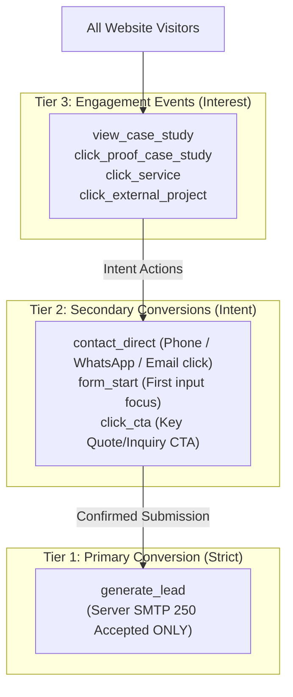
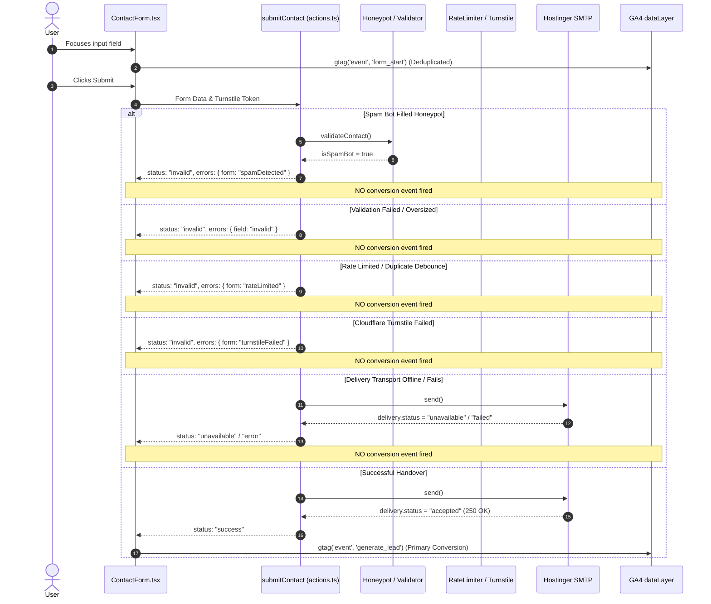

# NMark Designs — Phase 5A: GA4, Conversion Tracking & Analytics Readiness Audit

**Project:** NMark Designs Website Modernization  
**Repository:** `nikola93kg/nmarkdesigns`  
**Branch / Worktree:** `website_audit_phase_zero`  
**Phase Status:** Audit & Planning Complete (No tracking code implemented yet)  
**Date:** October 2026  
**Auditor / Strategy:** Senior Analytics Engineer & Digital Agency Strategist  

---

## 1. Executive Summary & Audit Context

Phase 5A conducts a comprehensive technical audit of the current analytics infrastructure on the NMark Designs website, identifies tracking deficiencies, establishes a privacy-conscious conversion hierarchy, and defines a robust event specification and implementation roadmap for Phase 5B.

### Current Baseline Findings:
1. **Minimal Base Tag Only:** GA4 is currently initialized via a rudimentary `gtag.js` loader in [`components/seo/GoogleAnalytics.tsx`](file:///Users/apple/.gemini/antigravity/worktrees/nmarkdesigns/website_audit_phase_zero/components/seo/GoogleAnalytics.tsx) embedded in the root localized layout [`app/[locale]/layout.tsx`](file:///Users/apple/.gemini/antigravity/worktrees/nmarkdesigns/website_audit_phase_zero/app/[locale]/layout.tsx).
2. **Zero Custom Event Tracking:** Not a single custom interaction event, micro-conversion, outbound link click, or lead conversion is currently tracked in the codebase.
3. **No Duplicate GA4 Scripts:** GA4 is included only once in `app/[locale]/layout.tsx`. No Google Tag Manager (GTM) container is present.
4. **Environment Isolation Gap:** The current GA4 loader only checks if `NEXT_PUBLIC_GA_MEASUREMENT_ID` matches `/^G-[A-Z0-9]+$/`. It does not restrict execution to production deployments (`DEPLOYMENT_ENV === "production"`), creating a risk that local development or preview deployments could pollute production analytics if the ID is populated.
5. **SPA Route Navigation Gap:** In Next.js App Router, `layout.tsx` does not remount on client-side route transitions (`next/link`). While GA4 Enhanced Measurement attempts to detect browser history changes, soft client navigations can produce delayed or missing pageviews unless explicitly synchronized.
6. **Zero PII Exposure Currently:** Because no custom event parameters are dispatched, no personal data is currently transmitted to Google Analytics. Future implementations must enforce strict sanitization.
7. **Contact Delivery Signal:** The contact Server Action ([`app/[locale]/[page]/actions.ts`](file:///Users/apple/.gemini/antigravity/worktrees/nmarkdesigns/website_audit_phase_zero/app/[locale]/[page]/actions.ts)) already provides a rigorous, verified signal (`delivery.status === "accepted"` via Hostinger SMTP, returning `status: "success"` to [`ContactForm.tsx`](file:///Users/apple/.gemini/antigravity/worktrees/nmarkdesigns/website_audit_phase_zero/components/contact/ContactForm.tsx)), providing a solid foundation for lead conversion tracking.

---

## 2. Existing GA4 Architecture & Codebase Review

### 2.1 Inspection of `components/seo/GoogleAnalytics.tsx`
```tsx
interface GoogleAnalyticsProps {
  measurementId?: string;
}

export function GoogleAnalytics({ measurementId }: GoogleAnalyticsProps) {
  const id = measurementId?.trim();
  if (!id) return null;
  if (!/^G-[A-Z0-9]+$/.test(id)) return null;

  return (
    <>
      <script
        async
        src={`https://www.googletagmanager.com/gtag/js?id=${encodeURIComponent(id)}`}
      />
      <script
        dangerouslySetInnerHTML={{
          __html: `
window.dataLayer = window.dataLayer || [];
function gtag(){dataLayer.push(arguments);}
gtag('js', new Date());
gtag('config', '${id}');
          `,
        }}
      />
    </>
  );
}
```

### 2.2 Architectural Findings & Deficiencies
| Audit Check | Current State | Assessment / Risk | Phase 5B Requirement |
| :--- | :--- | :--- | :--- |
| **Measurement ID Validation** | Regex `/^G-[A-Z0-9]+$/` | **Good:** Prevents script injection vulnerabilities. | Retain strict format validation. |
| **Script Tagging Strategy** | Native HTML `<script>` in `<head>` | **Moderate:** Unoptimized loading; could compete with critical CSS. | Migrate to Next.js native `<Script strategy="afterInteractive">` or `@next/third-parties/google`. |
| **Environment Conditioning** | Checks only string presence | **Deficiency:** Fires in development or preview if ID is present in environment. | Require `process.env.DEPLOYMENT_ENV === "production"` and production hostname check. |
| **Duplicate Tag Execution** | Rendered once in `app/[locale]/layout.tsx` | **Good:** No duplicate container or duplicate script injection. | Keep single layout boundary. |
| **SPA Route Tracking** | Relies entirely on GA4 Enhanced Measurement history pushState | **Risk:** Potential page title lag, delayed pageviews, or missed soft navigations. | Explicitly track route changes on `pathname` updates or configure GA4 `send_page_view: false` with manual pageviews. |
| **Content Security Policy (CSP)** | Hardened in `proxy.ts` | **Good:** `proxy.ts` whitelists `googletagmanager.com`, `google-analytics.com`, `doubleclick.net`. | Compatible with current CSP. |
| **GTM Integration** | Not present | **Clean:** Direct `gtag.js` implementation keeps bundle overhead minimal. | Avoid introducing heavy GTM containers. |

---

## 3. Conversion Hierarchy & Measurement Strategy

To prevent metric inflation and maintain absolute reporting integrity, measurement is structured into three distinct tiers:



### 3.1 Primary Conversion: `generate_lead`
- **Rule:** **Must ONLY fire upon confirmed successful processing and acceptance of a project inquiry.**
- **Strict Exclusions:**
  - Page visit to `/kontakt/` is **NEVER** a lead.
  - Clicking "Submit" is **NEVER** a lead.
  - Client-side validation pass is **NEVER** a lead.
  - Server validation errors (`status: "invalid"`) are **NEVER** a lead.
  - Honeypot bot traps (`spamDetected`) are **NEVER** a lead.
  - Rate-limited attempts (`rateLimited`) are **NEVER** a lead.
  - Cloudflare Turnstile rejections (`turnstileFailed`) are **NEVER** a lead.
  - SMTP transport failures or offline state (`status: "unavailable"` / `"error"`) are **NEVER** a lead.
- **Reliable Success Signal:** Fires **only** when `ContactForm.tsx` observes `state.status === "success"`, which guarantees that `actions.ts` received `delivery.status === "accepted"` from `contactDelivery.send(...)` (Hostinger SMTP returned 250 OK).

### 3.2 Secondary Conversions (High-Intent Actions)
These indicate commercial interest and alternative contact channels, but do **not** guarantee an ongoing inquiry:
1. `contact_direct`: Direct user action to initiate immediate communication:
   - Phone call tap: `tel:+381643005654`
   - WhatsApp message tap: `https://wa.me/381643005654`
   - Direct email tap: `mailto:info@nmarkdesigns.com`
2. `form_start`: The first meaningful interaction with the contact form (focus on name, email, or message field). Deduplicated per session.
3. `click_cta`: High-intent conversion button clicks:
   - Header "Zatražite ponudu" / "Request a Quote"
   - Hero primary CTA "Zatražite ponudu"
   - Services page quote CTA
   - Case study bottom inquiry CTA

### 3.3 Engagement Events (Content & Portfolio Discovery)
1. `click_proof_case_study`: Visitor clicks a case study card from Homepage or Portfolio showcase.
2. `view_case_study`: Visitor views a dedicated case study page (`/portfolio/[slug]/`).
3. `click_service`: Visitor clicks a specific service card to view details.
4. `click_external_project`: Visitor clicks outbound link to inspect the live client website.
5. `click_blog_to_service`: Visitor clicks an internal editorial CTA link navigating from a blog post to a commercial service.

---

## 4. Comprehensive Event Specification

Every event must be strictly typed, safe, and free of Personally Identifiable Information (PII).

| Event Name | Category | Trigger / DOM Location | Allowed Parameters | Deduplication | Consent Required | Testing Verification |
| :--- | :--- | :--- | :--- | :--- | :--- | :--- |
| **`generate_lead`** | **Primary Conversion** | `ContactForm.tsx` receives `state.status === "success"` | `page_type`, `locale`, `inquiry_type` | Exactly once per form submission state change | Analytics Consent | Playwright mock action test asserting `dataLayer.push` |
| **`contact_direct`** | **Secondary Conversion** | Click on `tel:`, `mailto:`, or WhatsApp link | `contact_method` (`phone`, `email`, `whatsapp`), `cta_location`, `locale` | Debounce 2000ms per link | Analytics Consent | Unit / E2E link click assertion |
| **`form_start`** | **Secondary Conversion** | First focus/input event in `ContactForm` fields | `page_type`, `locale` | Exactly once per page session (`useRef`) | Analytics Consent | Playwright form focus test |
| **`click_cta`** | **Secondary Conversion** | Click on primary quote / contact CTA button | `cta_name`, `cta_location`, `locale`, `destination` | Debounce 1000ms | Analytics Consent | Playwright button click assertion |
| **`view_case_study`** | **Engagement** | Landing on `/portfolio/[slug]/` | `project_slug`, `locale`, `project_category` | Once per route navigation | Analytics Consent | Playwright route change test |
| **`click_proof_case_study`**| **Engagement** | Click on a project card in portfolio grid | `project_slug`, `card_position`, `locale` | Debounce 1000ms | Analytics Consent | Playwright card click assertion |
| **`click_external_project`**| **Engagement** | Click "Pogledajte sajt" live external link | `project_slug`, `destination_domain` | Debounce 1000ms | Analytics Consent | Playwright outbound link assertion |
| **`click_service`** | **Engagement** | Click on a service card on homepage or services | `service_slug`, `locale` | Debounce 1000ms | Analytics Consent | Playwright service click assertion |

### 4.1 Strict PII Safeguard Policy
> [!CAUTION]
> **Zero Personally Identifiable Information:** Under no circumstances will any event parameter transmit:
> - User Name (`name`)
> - Email Address (`email`)
> - Phone Number (`phone`)
> - Message Content (`message`)
> - Freeform input text
> - Client budget numbers
> - IP Address (anonymized automatically by GA4, never collected in custom parameters)

The event dispatcher must include a compile-time TypeScript type guard and a runtime payload sanitizer that rejects any payload containing keys matching `/name|email|phone|message|text|comment|body/i`.

---

## 5. Contact Form Tracking Safety & State Analysis

A detailed review of [`ContactForm.tsx`](file:///Users/apple/.gemini/antigravity/worktrees/nmarkdesigns/website_audit_phase_zero/components/contact/ContactForm.tsx) and Server Action [`app/[locale]/[page]/actions.ts`](file:///Users/apple/.gemini/antigravity/worktrees/nmarkdesigns/website_audit_phase_zero/app/[locale]/[page]/actions.ts) confirms how submission outcomes are reported:



### Technical Deduplication in `ContactForm.tsx`:
To guarantee that `generate_lead` fires exactly once per confirmed inquiry:
1. Maintain an internal ref `hasFiredLeadRef = useRef(false)`.
2. When `state.status === "success"` and `!hasFiredLeadRef.current`:
   - Dispatch `trackEvent("generate_lead", { page_type: "contact", locale })`.
   - Set `hasFiredLeadRef.current = true`.
3. If the user edits the form and submits again later, the ref resets only after user inputs change.

---

## 6. Privacy, Legal Framework & Consent Strategy

### 6.1 Regulatory Context
The NMark Designs website serves two primary audiences:
1. **Domestic Market (Serbia):** Governed by the **Serbian Personal Data Protection Act** (*Zakon o zaštiti podataka o ličnosti — ZZPL*, Sl. glasnik RS, br. 87/2018), which closely models GDPR principles.
2. **International & EU Market:** Governed by the **EU General Data Protection Regulation (GDPR)** and the **ePrivacy Directive** (Directive 2002/58/EC as amended), which strictly mandate prior opt-in consent before setting non-essential cookies.

### 6.2 Current State Assessment
- **Cookies:** GA4 by default sets `_ga` and `_ga_<container-id>` cookies in the visitor's browser with a 2-year expiration and session duration.
- **Banner Status:** Currently, the website has **no cookie consent banner** and **no dedicated Privacy Policy page** (`/sr/politika-privatnosti/`).
- **IP Anonymization:** In GA4, IP anonymization is permanently enabled by default (Google does not log or store individual IP addresses).
- **Turnstile:** Cloudflare Turnstile runs in non-interactive / invisible mode and does not use advertising cookies.

### 6.3 Strategic Consent Options for the Owner
The owner must select one of the following three implementation strategies:

| Strategy | Description | Pros | Cons | Recommendation |
| :--- | :--- | :--- | :--- | :--- |
| **Option A: Full Google Consent Mode v2 Banner** | Load GA4 with `default: denied` for `analytics_storage`. Display a restrained, brand-styled cookie banner with "Prihvati sve" / "Odbij". Enable cookies only upon explicit user consent. | 100% GDPR & ePrivacy compliant; future-proof for Google Ads and EU traffic. | Reduces tracked visitor numbers by 20–40% due to banner rejections. | **Recommended for EU-focused business.** |
| **Option B: Restrained / Informational Banner** | Display an unobtrusive privacy notification banner linking to a Privacy Policy, using default GA4 configuration with IP anonymization. | Minimal UX friction; tracks 90%+ of non-adblock traffic; matches common Serbian agency practices. | Not strictly compliant with conservative EU GDPR interpretations for EU-domiciled visitors. | **Common in domestic Serbian market.** |
| **Option C: Cookieless Basic Analytics** | Configure GA4 to run in cookieless mode (`client_storage: 'none'`) or server pings. | Zero cookies set; requires no cookie banner under most privacy frameworks. | Lost session stitching across sessions; limited attribution accuracy. | Complex setup for marginal gain. |

> [!NOTE]
> *Disclaimer:* This technical assessment identifies architectural capabilities and industry best practices. It does not constitute formal legal counsel.

---

## 7. Google Search Console (GSC) Integration Plan

### 7.1 Verified Baseline Data (Sept 9 – Oct 6, 2026)
From [`docs/seo/phase-2b-content-opportunities.md`](file:///Users/apple/.gemini/antigravity/worktrees/nmarkdesigns/website_audit_phase_zero/docs/seo/phase-2b-content-opportunities.md):
- **Total Organic Clicks:** ~35
- **Total Impressions:** 1,133
- **Average CTR:** 3.1%
- **Average Position:** 13.1
- **Serbia Segment:** 338 impressions, 3 clicks, 25.6 average position (~0.9% CTR)
- **Top Click Driver:** `/en/blog/iphone-duo-responsive-web-dizajn/` (30 clicks, 551 impressions, pos 6.59) — broad non-commercial traffic.
- **Top Commercial Intent Driver:** `/sr/blog/koliko-kosta-izrada-web-sajta-u-srbiji-2026/` (282 impressions, pos 29, 0 clicks) — high purchase intent.

### 7.2 Search Console vs GA4 Measurement Role Distinction
Search Console and GA4 measure complementary halves of the user journey:

| Capability | Google Search Console (GSC) | Google Analytics 4 (GA4) |
| :--- | :--- | :--- |
| **Lifecycle Stage** | **Acquisition (Pre-click)** | **Behavior & Conversion (Post-click)** |
| **Primary Metrics** | Clicks, Impressions, CTR, Position | Sessions, Users, Engaged Sessions, Conversions |
| **Data Scope** | Google Search organic queries only | All traffic channels (Direct, Social, Referral, Search) |
| **Identity / Cookies** | Independent of user cookies or ad blockers | Affected by user consent and browser ad blockers |
| **Core Value** | "Are people discovering NMark Designs in Google?" | "Are visitors taking action and hiring NMark Designs?" |

### 7.3 Post-Launch Search Console Monitoring Framework
1. **Branded vs Non-Branded Query Split:**
   - Branded: *"nmark designs"*, *"nmark"*, *"nikola markovic"*
   - Commercial Non-Branded: *"izrada web sajtova beograd"*, *"izrada sajta cena"*, *"koliko kosta izrada sajta"*
2. **Landing Page Crawl & Indexation Health:**
   - Monitor URL Inspection status for 52 static routes.
   - Verify that canonical tags prevent duplication between `/sr/` and `/en/`.
3. **SERP Feature Tracking:**
   - Rich Snippets for FAQ Schema (`FAQPage`) on homepage.
   - Article Schema (`BlogPosting`) on editorial blog posts.

---

## 8. Reporting Dashboard Design (Looker Studio)

An independent digital studio needs a clear, lightweight, zero-maintenance dashboard to answer key business questions without requiring expensive third-party tools.

### 8.1 The Seven Core Studio Questions
| Business Question | Data Source | Primary Metric / Dimension |
| :--- | :--- | :--- |
| **1. How many visitors arrived?** | GA4 | Total Users, Sessions, Engaged Sessions |
| **2. Which sources brought them?** | GA4 | Session default channel group / Source / Medium |
| **3. Which services attracted interest?** | GA4 | Event `click_service` count + Pageviews to `/usluge/` |
| **4. Which case studies were viewed?** | GA4 | Event `view_case_study` & `click_proof_case_study` breakdown by `project_slug` |
| **5. Which CTAs were clicked?** | GA4 | Event `click_cta` & `contact_direct` breakdown by `cta_location` |
| **6. How many genuine inquiries were submitted?** | GA4 | **`generate_lead`** event count (100% verified) |
| **7. Which journeys contributed to inquiries?** | GA4 | First-user source / Medium & User Path exploration to `generate_lead` |

### 8.2 Recommended Dashboard Architecture: Google Looker Studio
A free 2-page Looker Studio dashboard connected natively to GA4 and GSC:

#### Page 1: Executive Studio Overview & Inquiries
- **Top Scorecards:** Total Leads (`generate_lead`), Conversion Rate (Leads / Sessions), Direct Inquiries (`contact_direct`), Engaged Sessions.
- **Trend Chart:** Weekly Inquiries vs Sessions over time.
- **Channel Breakdown:** Sessions and Leads by Channel (Organic Search, Direct, WhatsApp/Instagram, Referral).
- **Portfolio Performance Table:** Case studies ranked by views and outbound live site clicks.
- **CTA Efficiency Table:** CTA locations ranked by clicks.

#### Page 2: Organic Search & Content Intelligence
- **Top Scorecards:** Total Clicks, Total Impressions, Average CTR, Average Position.
- **Query Matrix:** Top commercial queries (impressions, clicks, position) highlighting high-potential keywords on positions 4–15.
- **Top Organic Landing Pages:** Blog vs Core Commercial pages performance.
- **Geographic Distribution:** Serbia vs International visitors.

*Cost:* **$0 / month** (eliminates Hotjar, Mixpanel, and paid SaaS subscriptions).

---

## 9. Measurement Reliability & Known Edge Cases

| Challenge / Edge Case | Risk Level | Mechanism / Impact | Mitigation Strategy |
| :--- | :---: | :--- | :--- |
| **Client-Side Ad Blockers** | Medium | uBlock Origin / Brave Shields block `googletagmanager.com` for 15–25% of tech visitors. | Accepted standard for web analytics. No intrusive server-side proxy bypass. |
| **SPA Soft Navigations** | Medium | Next.js App Router client navigation may not trigger default GA4 pageviews. | Explicitly track route changes on `usePathname()` or use `@next/third-parties/google`. |
| **Double Pageviews** | High | Firing custom `page_view` while GA4 `config` has `send_page_view: true` doubles pageview count. | Set `send_page_view: false` in `gtag('config')` if managing route transitions manually. |
| **Bot Traffic / Spam Submissions** | Low | Bot filling forms could trigger fake leads. | Mitigated: Honeypot & Turnstile reject bots before SMTP; `generate_lead` fires **only** on SMTP 250 success. |
| **Locale Switching** | Low | Switching between `/sr/` and `/en/` triggers soft nav. | Preserves accurate `locale` parameter in all events. |
| **Environment Leakage** | Medium | Local dev or preview deployment tracking polluting production. | Gate analytics execution behind `process.env.DEPLOYMENT_ENV === "production"` and production domain check. |

---

## 10. Technical Implementation Plan for Phase 5B

### 10.1 Module Architecture
Phase 5B will establish a centralized, typed event dispatcher:
`lib/analytics.ts`

```ts
// Conceptual design for Phase 5B (DO NOT IMPLEMENT IN PHASE 5A)
export type AnalyticsEvent =
  | "generate_lead"
  | "contact_direct"
  | "form_start"
  | "click_cta"
  | "view_case_study"
  | "click_proof_case_study"
  | "click_external_project"
  | "click_service";

export interface EventParams {
  generate_lead: { page_type: string; locale: string };
  contact_direct: { contact_method: "phone" | "email" | "whatsapp"; cta_location: string; locale: string };
  form_start: { page_type: string; locale: string };
  click_cta: { cta_name: string; cta_location: string; locale: string };
  view_case_study: { project_slug: string; locale: string };
  click_proof_case_study: { project_slug: string; locale: string };
  click_external_project: { project_slug: string; destination_domain: string };
  click_service: { service_slug: string; locale: string };
}
```

### 10.2 Expected File Modifications in Phase 5B
1. **`lib/analytics.ts` (New File):**
   - Type-safe `trackEvent()` function.
   - PII runtime scrubber.
   - Production environment guard (`isProduction && isBrowser && window.gtag`).
2. **`components/seo/GoogleAnalytics.tsx`:**
   - Environment guard restricting script injection to production environments.
   - SPA route tracking synchronization.
3. **`components/contact/ContactForm.tsx`:**
   - Attach `form_start` on first input focus.
   - Attach `generate_lead` on confirmed `state.status === "success"`.
4. **`components/layout/Footer.tsx` & `components/contact/ContactPage.tsx`:**
   - Attach `contact_direct` click listeners on Phone, Email, and WhatsApp links.
5. **`components/portfolio/PortfolioShowcase.tsx` & Case Study Components:**
   - Attach `click_proof_case_study` and `click_external_project` tracking.
6. **`tests/analytics.spec.ts` (New Test File):**
   - Mock `window.dataLayer` in Playwright and verify that all events dispatch correct schemas without PII.

---

## 11. Baseline Verification & Quality Gates

The repository baseline prior to Phase 5B implementation is completely green:
- **`npm run typecheck`:** **PASSED** (0 errors)
- **`npm run lint`:** **PASSED** (0 errors, 0 warnings)
- **`npm run build`:** **PASSED** (52/52 static pages compiled)
- **Playwright Test Suite:** **255 / 255 tests passed**
- **Working Tree:** Clean (`website_audit_phase_zero`)

---

## 12. Required Owner Decisions

Before implementing Phase 5B, the owner should decide:

1. **GA4 Measurement ID Selection:**
   - Confirm whether to continue using the existing Google Analytics 4 property ID (`G-TVJKFZRKRJ` from the legacy WordPress site) or create a fresh, clean GA4 property for the Next.js rebuild.
2. **Privacy & Cookie Consent Strategy:**
   - **Option A:** Full Consent Mode v2 banner with Accept/Decline (Strict EU GDPR compliance).
   - **Option B:** Unobtrusive notice banner with standard GA4 IP-anonymized tracking (Standard Serbian market approach).
3. **Reporting Preference:**
   - Confirm whether to set up the recommended free Google Looker Studio dashboard or rely directly on the native Google Analytics 4 console.
